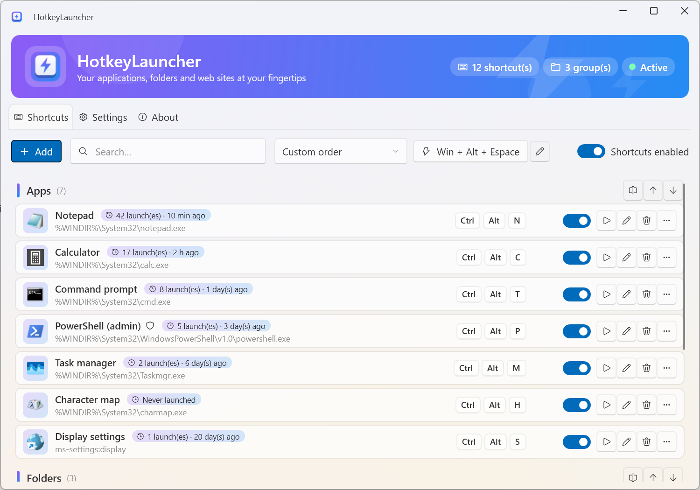
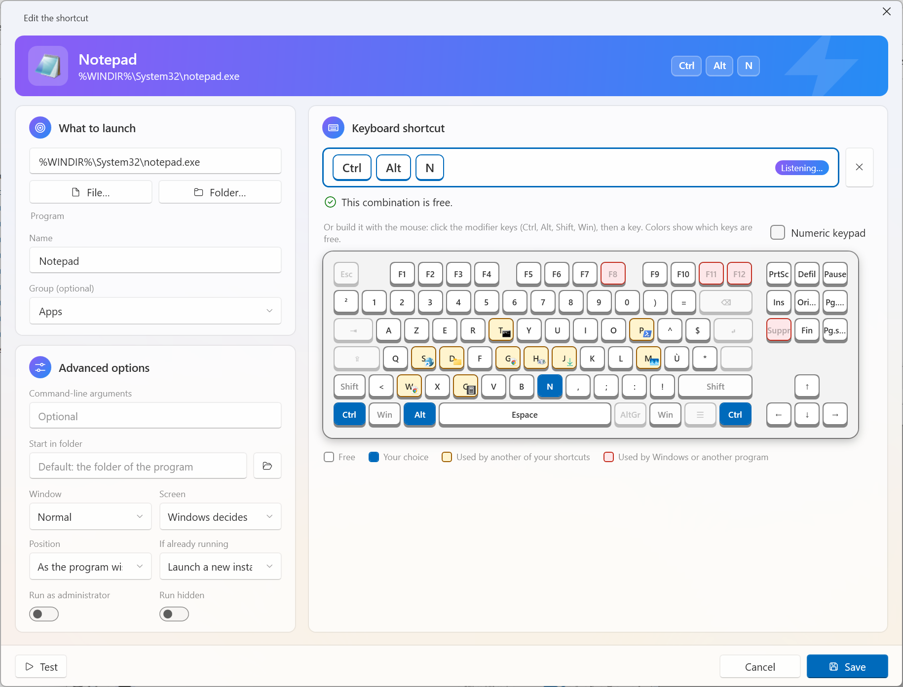
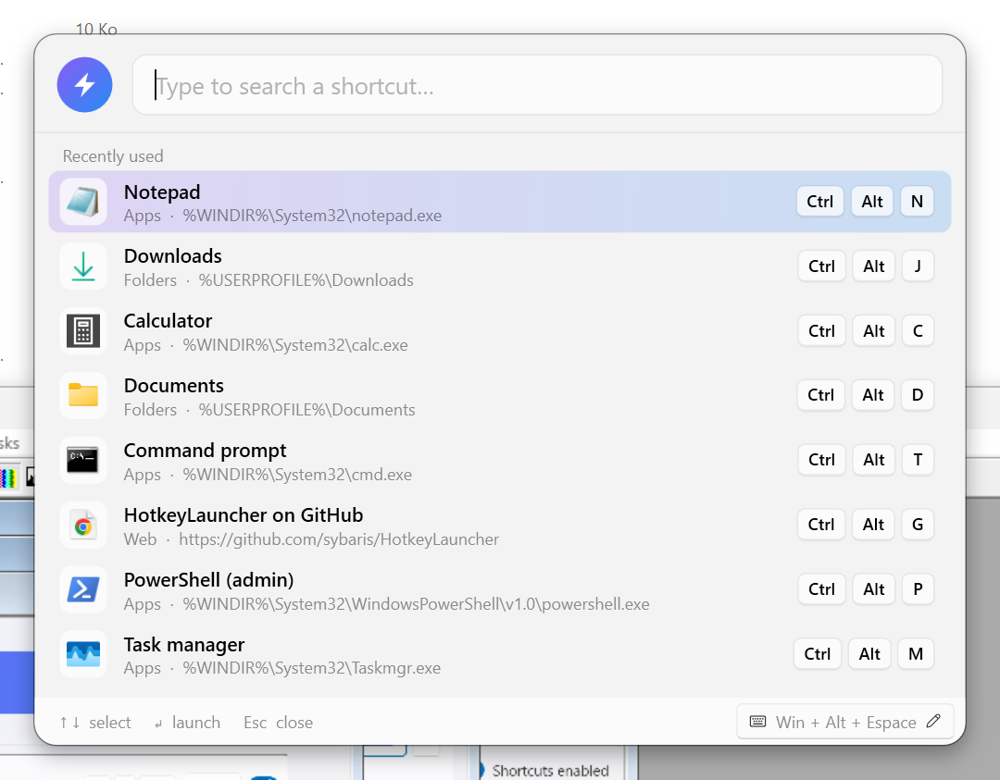
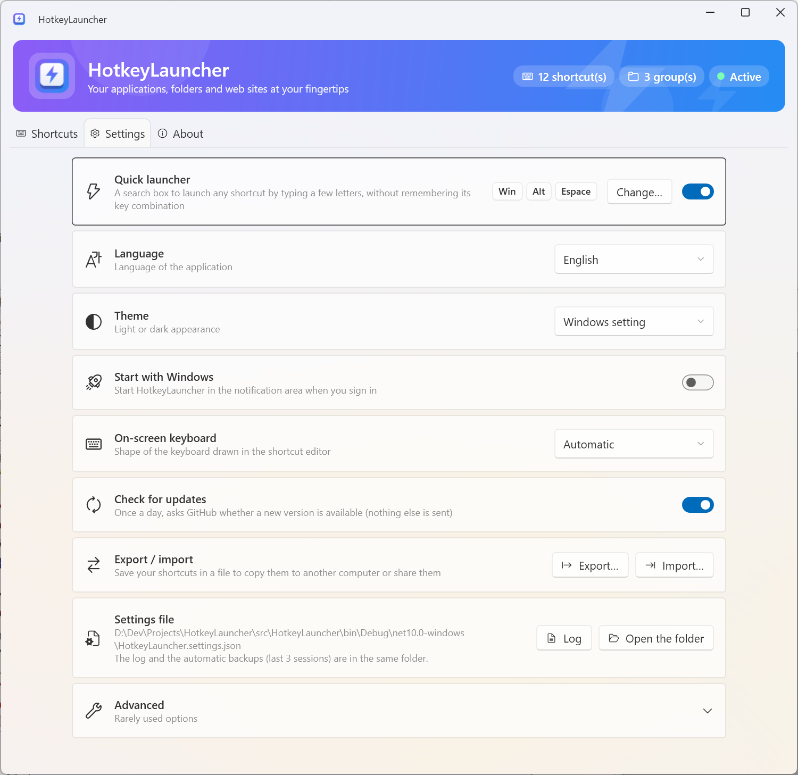

<p align="center">
  
</p>

<h1 align="center">HotkeyLauncher</h1>

<p align="center">
  Launch your applications, folders and favorite web sites in a blink, with global keyboard shortcuts.<br>
  <a href="#français">Version française plus bas</a>
</p>

<p align="center">
  <a href="https://github.com/sybaris/HotkeyLauncher/actions/workflows/ci.yml"></a>
  <a href="https://github.com/sybaris/HotkeyLauncher/releases/latest"></a>
  <a href="LICENSE"></a>
</p>

> **Note**: This project was 99% generated by [Claude Opus 5.5](https://www.anthropic.com/claude) using [Claude Code](https://www.anthropic.com/claude-code).

<p align="center">
  
  
</p>
<p align="center">
  
  
</p>

---

## Features

**Launch anything**
- **Global shortcuts** – press `Ctrl + Alt + N` anywhere and Notepad opens.
- Programs (with arguments and start-in folder), **scripts** (`.ps1`, `.bat`, `.cmd`, `.vbs`), documents, folders, web sites and links (`https://`, `mailto:`, `ms-settings:`…).
- **Run as administrator** or **run hidden** (handy for scripts).
- **If already running: bring its window to the front** instead of starting a new instance (optional, per shortcut).
- **Window position**: choose the screen and place the window centered or on a half of the screen.

**Find your shortcuts**
- **Quick launcher** – press `Win + Alt + Space`, type a few letters (`vsc` finds *Visual Studio Code*), press Enter.
- **Notification-area icon** – left click: menu to launch any shortcut, with a search box; double click: main window; right click: enable / disable all shortcuts, exit.
- **Groups**, **drag & drop reordering**, sort by name / most used / recently used, **usage statistics** on each shortcut.

**Choose key combinations easily**
- Type the combination, or build it with the mouse on an **on-screen keyboard** that follows your layout (AZERTY, QWERTY, QWERTZ…, ISO or ANSI shape, optional numeric keypad) and shows at a glance which keys are **free**, **already used by one of your shortcuts**, or **taken by Windows / another program**. Free combinations are suggested.

**Everyday comfort**
- **Portable** – no installer, settings stored in a JSON file next to the executable, **automatic backups** of the last 3 sessions, a **log file** for troubleshooting.
- **Export / import** your shortcuts to copy them to another computer.
- **Undo** after deleting a shortcut.
- **Start with Windows** (per user, no administrator rights needed), **update notifications** (once a day, can be disabled).
- **Light / dark theme** (Windows 11 Fluent look), interface in **English, French, Spanish and German**.

## Download

Get the latest version from the [Releases page](https://github.com/sybaris/HotkeyLauncher/releases/latest):

| File | For |
|------|-----|
| `HotkeyLauncher-x.y.z-win-x64-portable.zip` | **Recommended.** Windows 10/11 64-bit, nothing to install |
| `HotkeyLauncher-x.y.z-win-x64-light.zip` | Smaller download, requires the [.NET 10 Desktop Runtime](https://dotnet.microsoft.com/download/dotnet/10.0) |
| `HotkeyLauncher-x.y.z-win-arm64-*.zip` | Windows on ARM |

Unzip the archive in any folder (for instance `C:\Tools\HotkeyLauncher`) and run `HotkeyLauncher.exe`.

> The executable is not signed: on first launch Windows SmartScreen may display a warning. Click *More info* → *Run anyway*.

Or with a package manager:

```powershell
winget install Sybaris.HotkeyLauncher
choco install hotkeylauncher
scoop bucket add sybaris https://github.com/sybaris/scoop-bucket; scoop install hotkeylauncher
```

(See [packaging/README.md](packaging/README.md). With winget and Chocolatey the settings are stored in `%APPDATA%\HotkeyLauncher`.)

## Usage

1. Click **Add**, choose what to launch (or drop it on the window).
2. Click in the shortcut box and press your combination – or click the keys of the on-screen keyboard.
3. Save. The shortcut works immediately, from any application.

Closing the window keeps HotkeyLauncher running in the notification area. Use *Exit* from the icon's right-click menu to stop it.

### Command line

| Option | Effect |
|--------|--------|
| *(none)* | Opens the main window (or brings the running instance to the front) |
| `/setup` | Same, kept for RapidApp compatibility |
| `--tray` | Starts hidden in the notification area (used by *Start with Windows*) |
| `/?`, `--help` | Displays the help |

### Files

| File | Content |
|------|---------|
| `HotkeyLauncher.settings.json` | Settings and shortcuts |
| `HotkeyLauncher.log` | Log (start, errors, shortcuts that could not be registered) |
| `backups\` | The settings file as it was at the start of the last 3 sessions |

They are next to `HotkeyLauncher.exe`. If that folder is read-only (e.g. under `Program Files`), `%APPDATA%\HotkeyLauncher` is used instead. The exact location is shown in *Settings*.

## History

HotkeyLauncher is the successor of **[RapidApp](https://sourceforge.net/projects/rapidapp/)**, a hotkey launcher written in Delphi between 2003 and 2005. RapidApp users can import their `RapidApp.ini` from *Settings → Advanced → Import from RapidApp*.

## Building

Requirements: Windows and the [.NET 10 SDK](https://dotnet.microsoft.com/download/dotnet/10.0).

```powershell
dotnet build                     # build
dotnet test                      # unit tests
dotnet run --project src/HotkeyLauncher

# Portable single-file executable
dotnet publish src/HotkeyLauncher -c Release -r win-x64 --self-contained -p:PublishSingleFile=true -p:IncludeNativeLibrariesForSelfExtract=true -p:EnableCompressionInSingleFile=true -o publish
```

| Folder | Content |
|--------|---------|
| `src/HotkeyLauncher.Core` | Model, settings, launching, search, imports (no UI, unit tested) |
| `src/HotkeyLauncher` | WPF application ([WPF-UI](https://github.com/lepoco/wpfui) Fluent controls, MVVM with [CommunityToolkit.Mvvm](https://github.com/CommunityToolkit/dotnet)) |
| `tests/` | xUnit tests of the core and of the view models |
| `tools/` | Translations (`strings.tsv`) and the script generating the `.resx` files |
| `packaging/` | Scoop and winget manifests |

### Releasing

Every push on `main` is built and tested by the CI. To publish a release, push a version tag:

```powershell
git tag v1.0.0
git push origin v1.0.0
```

The *Release* workflow builds the 4 zip files, `SHA256SUMS.txt` and the Scoop manifest, and creates the GitHub release. A tag with a suffix (`v1.1.0-beta.1`) creates a pre-release.

### Translations

All the texts are in [`tools/strings.tsv`](tools/strings.tsv) (one column per language). After a change, regenerate the resources with `python tools/make_resx.py`.
To add a language: add a column, then declare it in `Localizer.Languages` and in `SatelliteResourceLanguages` (`Directory.Build.props`). Contributions are welcome!

## License

[MIT](LICENSE) © Jean-Pierre Planas

---

## Français

**HotkeyLauncher** lance vos applications, dossiers et sites favoris en un éclair, grâce à des raccourcis clavier globaux.

> **Note** : ce projet a été généré à 99 % par Claude Opus 5.5 avec Claude Code.

### Fonctionnalités

- **Raccourcis globaux** : appuyez sur `Ctrl + Alt + N` depuis n'importe où et le Bloc-notes s'ouvre.
- **Tout se lance** : programmes, **scripts** (`.ps1`, `.bat`, `.cmd`, `.vbs`), documents, dossiers, sites web et liens ; en **administrateur** ou **masqué** si besoin.
- **Si déjà lancé : mettre la fenêtre au premier plan** au lieu d'ouvrir une nouvelle instance (au choix, par raccourci).
- **Position de la fenêtre** : choix de l'écran, fenêtre centrée ou sur une moitié d'écran.
- **Lanceur rapide** : `Win + Alt + Espace`, tapez quelques lettres (`vsc` trouve *Visual Studio Code*), Entrée.
- **Icône de notification** : clic gauche = menu des raccourcis avec recherche ; double-clic = fenêtre principale ; clic droit = activer / désactiver, quitter.
- **Groupes**, **réorganisation par glisser-déposer**, tri par nom / les plus utilisés / récents, **statistiques d'utilisation**.
- **Un choix de raccourci qui vous aide** : clavier visuel qui suit votre disposition (AZERTY, QWERTY…, forme ISO ou ANSI, pavé numérique en option) et montre les touches **libres**, **déjà utilisées par un de vos raccourcis** ou **prises par Windows / un autre programme**, avec des suggestions.
- **Portable**, **sauvegardes automatiques** (3 dernières sessions), **journal**, **export / import**, **annulation** après suppression, **démarrage avec Windows**, **notification des mises à jour**.
- **Thème clair / sombre** et interface en **français, anglais, espagnol et allemand**.

### Installation

Téléchargez la dernière version sur la [page des releases](https://github.com/sybaris/HotkeyLauncher/releases/latest) (fichier `win-x64-portable.zip` recommandé), décompressez-la dans un dossier de votre choix et lancez `HotkeyLauncher.exe`.

Ou avec un gestionnaire de paquets : `winget install Sybaris.HotkeyLauncher`, `choco install hotkeylauncher`, ou `scoop bucket add sybaris https://github.com/sybaris/scoop-bucket` puis `scoop install hotkeylauncher`.

> L'exécutable n'est pas signé : au premier lancement, Windows SmartScreen peut afficher un avertissement. Cliquez sur *Informations complémentaires* → *Exécuter quand même*.

### Anciens utilisateurs de RapidApp

HotkeyLauncher succède à **[RapidApp](https://sourceforge.net/projects/rapidapp/)** (Delphi, 2003 – 2005). Vos raccourcis s'importent depuis *Paramètres → Avancé → Importer depuis RapidApp*, en sélectionnant votre fichier `RapidApp.ini`.
